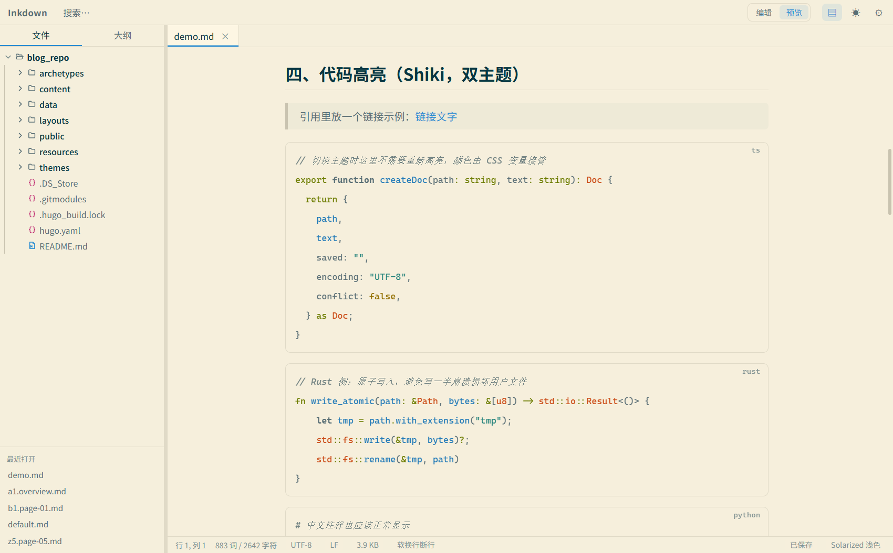
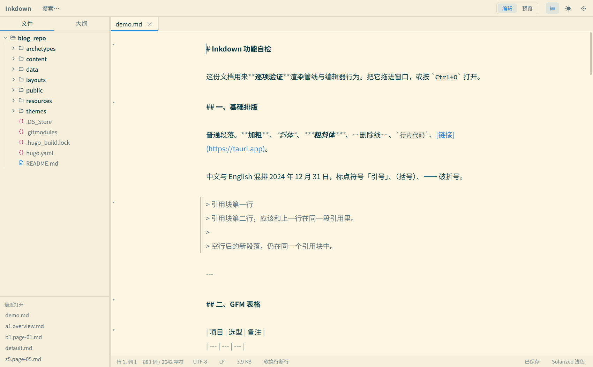
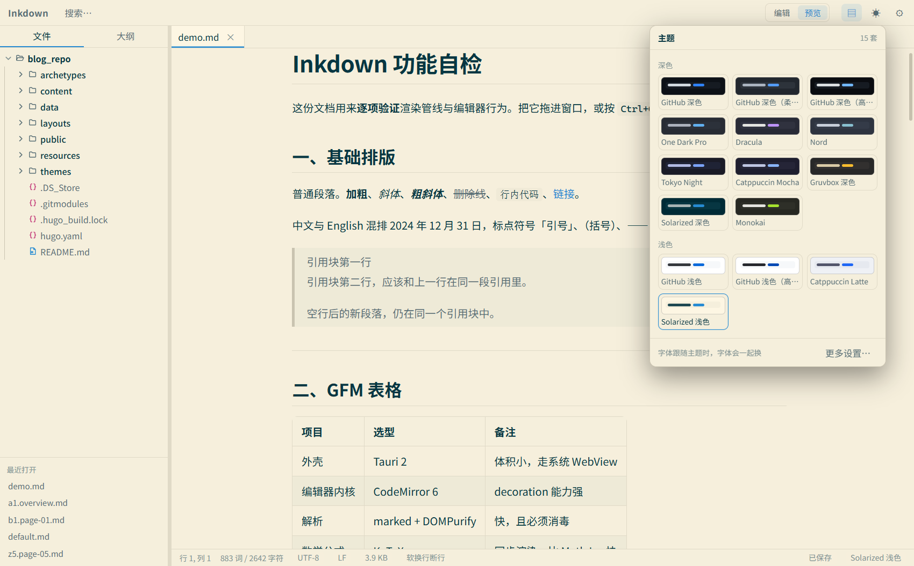

<div align="center">
  
</div>

<h1 align="center">Inkdown · 墨下</h1>

<p align="center"><b>为中文写作而做的 Markdown 阅读 · 编辑器</b></p>

<p align="center">
  一个不打扰思路的本地 Markdown 工具。Typora 式排版、15 套主题、<br />
  代码高亮随主题切换，打开别人发来的 md 也不会执行脚本。
</p>

<p align="center">
  <a href="CHANGELOG.md"></a>
  <a href="https://tauri.app"></a>
  <a href="https://react.dev"></a>
  <a href="https://www.rust-lang.org"></a>
  <a href="../../releases"></a>
  <a href="LICENSE"></a>
  <a href="docs/DEVELOPMENT.md"></a>
</p>

<p align="center">
  <a href="#截图">截图</a> ·
  <a href="#功能">功能</a> ·
  <a href="#当前状态">当前状态</a> ·
  <a href="#下载">下载</a> ·
  <a href="#从源码运行">从源码运行</a> ·
  <a href="#已知边界">已知边界</a>
</p>

<p align="center"><sub>版本 <b>0.3.0</b> ｜ Windows 已出包 ｜ macOS 待构建验证 ｜ <b>未签名</b></sub></p>

---

## 截图

<div align="center">
  
  <br />
  <sub>预览 · Typora 式排版 · 代码块右上角标注语言 · 文件树按类型显示图标</sub>
</div>

| 编辑器 | 主题 |
| :---: | :---: |
|  |  |
| <sub>语法着色 + 行级装饰（标题放大、引用弱化）</sub> | <sub>15 套主题，深色 / 浅色分组，点色块即所见</sub> |

## 功能

**界面**

- 顶栏只放**入口**，不放动作：搜索、编辑/预览开关、侧栏、主题、设置。
  原来那一排按钮（打开/文件夹/新建/保存 + 加粗/斜体/链接/行内代码/引用/整段贴左/
  列表补标记/结构自检）已经撤掉——前四个有快捷键，其余在搜索面板里输入名字就能用
- **一个搜索面板**（`Ctrl+P`）：同一个输入框既搜命令也搜文件，命令排在文件前面，
  结果按「命令 / 文件」分组。以前拆成"跳转"（文件）与"命令"两个入口，
  用户得先想清楚自己要找的东西算文件还是算功能——而在脑子里这本来就是一件事
- **编辑 / 预览整幅切换**（`Ctrl+Shift+V`，或顶栏的「编辑 | 预览」）：不再左右对照，
  正文占满窗口，中文长段落不再被挤成窄条；切过去时按当前位置对齐（设置里可关）
- **主题点开就选**：顶栏的 ☾ 与状态栏右下角的主题名，点一下**贴着它弹出主题选择浮层**
  （深色/浅色分组、15 套、色块即真实配色），点一套立刻生效并收起；点空白处或 Esc 关闭。
  以前点击是"换下一个同色系主题"，按十几次才碰到想要的那套，而且看不出会跳到哪
- **设置是居中弹窗，左侧四个分类**（外观 / 编辑器 / 预览 / 工作区）：设置项涨到二十多项后，
  一屏平铺要来回扫，分类之后每组只有 3–6 项；⚙ 是开关（再点一次收起），
  点弹窗外面或 Esc 关闭
- **保存提示只在"真的有改动"时弹一次**：连按 `Ctrl+S` 不会再每按一次弹一遍「已保存」。
  写盘行为没变——显式保存永远真写（见"数据安全"），只是没有改动时不再打扰
- 窄窗口下顶栏不再被裁：按钮少了，右侧的开关不会被挤出可视区

**编辑**

- CodeMirror 6，markdown 语法高亮 + 行级装饰（标题放大、代码块底纹、引用弱化）
- 围栏里的代码**按语言高亮**（json / ts / python / rust / sql…，语言按需异步加载），
  配色跟随主题的 `--code-*` 变量
- 快捷键：`Ctrl+B/I/E/K` 加粗/斜体/行内代码/链接，`Ctrl+F` 查找替换
- 打字机模式（光标行居中）、自动保存、可配置字号/行高/字宽
- 中文输入法安全：组合期不重排装饰、不移动滚动

**预览**

- GFM（表格、任务列表、删除线、自动链接）、数学公式（KaTeX）、图表（Mermaid）
- 代码高亮走 Shiki，配色随主题切换；**代码块右上角标注语言**（Typora 的做法）
- 严格消毒（DOMPurify）：打开别人发来的 md 不会执行脚本
- **排版按 Typora 的阅读观感重做**：正文限宽 46em 居中、标题带下边框且行高收紧（1.3）、
  正文沿用用户的行高设置（中文默认 1.85）、块间统一 1.1em 节奏、**首个元素不吃上边距**
  （以标题开头的文档不再凭空空出一块）、引用块给淡底 + 4px 左边线、图片独占一行居中、
  嵌套列表换标记（disc → circle → square）、脚注收在文末并加分隔线
- 表格：表头默认左对齐（GitHub 风格），但 **GFM 的 `:---:` / `---:` 对齐仍然生效**
  —— 默认规则写成 `th:not([align])`，否则作者样式会盖掉 marked 输出的 `align` 属性
  （这条回归有专门的单测与真机验证，见下文）

**大纲导航**

- 点大纲**编辑器与预览各自响应**：编辑视图下滚编辑器，预览视图下滚预览。
  以前只滚编辑器，而预览视图下编辑器是 `display:none`，所以点了等于没反应
- 点哪一节，那一节就**贴在视口顶部**（留 16px 余量）；滚动预览时大纲**自动高亮**
  当前正在读的章节（判定线在视口顶部下方 1/4 处），读长文档不会迷路
- 跳转后会做**逐帧校正**：图片加载、Shiki 替换代码块都会改变高度，
  一次测量常偏几百像素，会在下一帧与 120ms 后各校正一次（用户自己滚走了则不抢）

**文件**

- 文件树、多标签、新建/重命名/删除（回收站）、在文件管理器中显示
- 文件树：**每层一条竖直导轨**，一层缩进 19px，文件夹比文件重一档——
  层级不靠数缩进；展开箭头是 **SVG 折角线**（展开时转 90°），小字号下不会糊成一团；
  工作区根目录也能点着收起/展开；`F5` 刷新，刷新与保存**不会**把已展开的目录收回去
- 文件树**按类型显示图标**：文件夹分合上/打开两种（展开状态一眼可见），文件按
  Markdown / 图片 / 代码 / 配置 / 文本 / 其它分开，颜色取主题的代码色，15 套主题自动适配。
  用内联 SVG 而不是 emoji——emoji 在 Windows 上会被渲染成彩色字形、跟主题脱节，
  而且 Win10 与 Win11 长得不一样
- 编码往返：UTF-8 / GB18030 / Big5 原样保存，BOM 与 CRLF/LF 保留
- 外部变更检测：文件被别的程序改过会提示，**绝不静默覆盖任何一边**
- 原子写入（临时文件 + rename），写一半崩溃不会损坏原文件

**主题（15 套）**

设置面板里直接选，点色块即所见：

| 深色 | 浅色 |
| --- | --- |
| GitHub 深色 · GitHub 深色（柔和）· GitHub 深色（高对比） | GitHub 浅色 · GitHub 浅色（高对比） |
| One Dark Pro · Dracula · Nord · Tokyo Night | Catppuccin Latte |
| Catppuccin Mocha · Gruvbox 深色 · Solarized 深色 · Monokai | Solarized 浅色 |

GitHub 家族覆盖了官方全部变体：现代深色/浅色（`github-dark-default` /
`github-light-default`）、柔和深色（dimmed）与两组高对比（无障碍）配色。

- 每套主题包含**界面配色**、**代码高亮配色**与**推荐字体**三部分，成对定义
- **字体跟随主题**（默认开启）：切主题时字体一起换，主题才像一套完整外观；
  关掉开关后 `fontPreset` 是唯一依据
- **编辑器语法色按主题各配一套**：关键字/字符串/注释/数字/函数名/类型名六类互不重复
- 顶栏 ☾ / 状态栏主题名**点开就是选择浮层**（见「界面」一节），右键换明暗
- 换主题会清掉按主题缓存的代码高亮与图表，不会出现"界面换了、代码还是旧配色"
- 旧的 `dark` / `light` 设置会自动迁移，不会丢失用户的选择

主题定义集中在 `src/services/themes.ts`（配色 + Shiki 主题名 + 预览色块），
CSS 变量在 `src/styles/index.css`。**两边的色值由测试强制保持一致**——
设置面板里的小色块取注册表，真实界面取 CSS，对不上就等于给用户看假的预览。

**对比度是可测的，所以测了。** 加主题最容易犯的错是直接照搬配色方案的官方色值，
看着"正宗"，但在自己的背景上根本读不清。实测就撞到两类：

| 问题 | 实例 |
| --- | --- |
| 官方色板本身低对比 | Solarized 深色的正文只有 **5.6**（正文标准 7）；One Dark 的次要文字只有 3.7（标准 4.5） |
| 按钮文字写死白色 | 主按钮是"强调色底 + 白字"，而 **15 套里只有 4 套**的强调色深到白字能读——Gruvbox 的亮黄只有 **1.70**、Monokai 的亮绿只有 **1.55**，基本等于看不见 |
| 代码块底色选错把 token 压暗 | Shiki 的 token 配色按**它自己主题的背景**调，而预览把底色统一成了 `--bg-sunken`。浅色主题尤其严重（Catppuccin Latte 46 处、Solarized 浅色 79 处低于可读阈值） |
| 编辑器语法配色不分层 | 编辑器只复用 4 个通用变量，于是**关键字与函数名同色、数字与类型名同色**；遇到 Gruvbox（`--accent`=`--warn`=`#fabd2f`）四类撞成一片黄，Monokai（`--accent`=`--ok`=`#a6e22e`）三类撞成一片绿 |

处理方式：保持色相微调亮度到达标，新增 `--accent-fg` / `--danger-fg`
两个变量（在 `:root` 给默认值、由少数主题覆盖，靠 CSS 变量继承），
把 `--bg-sunken` 调整到贴近对应 Shiki 主题的底色，
并为每套主题单独定义 6 个 `--code-*` 语法色。

测试按 WCAG 卡阈值：正文 ≥7、次要文字 ≥4.5、填充按钮 ≥4.5；
语法色关键字 ≥4.5、其余 ≥3 且**六类互不重复**。
另外卡一条**我们自己能保证的不变量**：换底色后 token 的对比度不能比用主题原底色时
差 10% 以上——官方配色里"注释"本来就被刻意弱化（Nord 2.4、Tokyo Night 2.5），
在它自己的底色上也不达标，那是设计选择，不该由我们去改。
**以后新增主题不过这几关就进不来。**

## 当前状态

**可以日常使用，但还不是可以正式分发的完成品。** 分方面说清楚：

| 方面 | 状态 |
| --- | --- |
| 写作 / 阅读 / 文件管理 | ✅ 可用。这条主线上的功能都跑通了，并逐项验证过（见 [验证方式](docs/DEVELOPMENT.md#验证方式)） |
| Windows 分发 | ⚠️ 可安装，但**未签名** —— 首次安装会弹 SmartScreen，需点「更多信息 → 仍要运行」 |
| macOS 分发 | ⚠️ 安装包由 CI 在 macOS 上构建；**未签名、未公证**，首次打开需右键 →「打开」或 `xattr` 去隔离 |
| Linux 分发 | ⚠️ 出 AppImage / deb / rpm；**未在多种发行版上验证过**，glibc 要求见下文 |
| 全库搜索 · Git 集成 · PDF/DOCX 导出 · 大文件虚拟化 · 单实例转发 | ❌ 未实现，见 [路线图](docs/DEVELOPMENT.md#路线图) |

所以它现在是一匹**能干活的马**，不是一件可以上架卖的商品：功能主线齐了，
缺的是分发所需的签名与公证，以及几个明确列在路线图里的能力。

## 下载

安装包发布在 **[Releases](../../releases)**，每个版本一份，按平台挑：

| 平台 | 文件 | 说明 |
| --- | --- | --- |
| Windows | `Inkdown_<版本>_x64-setup.exe` | 推荐。按当前用户安装，不需要管理员权限 |
| Windows | `Inkdown_<版本>_x64_en-US.msi` | 给需要 MSI 的场景（企业部署） |
| macOS（Apple Silicon） | `Inkdown_<版本>_aarch64.dmg` | M1/M2/M3… |
| macOS（Intel） | `Inkdown_<版本>_x64.dmg` | 老款 Mac |
| Linux | `Inkdown_<版本>_amd64.AppImage` | 免安装，`chmod +x` 后直接跑 |
| Linux | `inkdown_<版本>_amd64.deb` / `.rpm` | Debian/Ubuntu 与 Fedora/openSUSE |

> 三平台安装包由 [GitHub Actions](.github/workflows/release.yml) **在各自的原生机器上**构建，
> 不是在一台机器上交叉编译 —— Tauri 不支持交叉编译，macOS/Linux 的包必须在对应系统上打。

> ⚠️ **全部未签名**：
> - Windows 首次运行会触发 SmartScreen，点「更多信息 → 仍要运行」；
> - macOS 首次打开若提示"已损坏"或"无法验证开发者"，用
>   `xattr -dr com.apple.quarantine /Applications/Inkdown.app` 放行，或右键 →「打开」；
> - Linux 的 AppImage 需要 `libwebkit2gtk-4.1`（Ubuntu 22.04+ 自带；较旧的发行版请用 deb/rpm 让包管理器处理依赖）。

> ⚠️ **从旧名字升级**：这个项目以前叫 MDDeveloper。装过旧版的话请先卸载，
> 再装 Inkdown —— 两者的安装目录不同，不卸载会在系统里留下两条记录。
> 设置与「最近打开」是共享的（应用标识没变），不会丢。

## 从源码运行

```bash
npm install
npm run app          # = tauri dev，启动桌面窗口
npm run app:build    # = tauri build，打安装包
npm test             # 318 个前端用例
npm run rust:test    # 15 个后端用例
```

合计 **333 个自动化用例**（318 前端 + 15 后端），另有 6 个在真实应用里跑的
CDP 验证脚本（见[开发文档](docs/DEVELOPMENT.md#验证方式)）。

环境要求：Node 20+、Rust 1.88+（`rustup update stable`）、Windows 需 WebView2（Win10/11 自带）。

命令行直接打开文件或目录：

```bash
npm run app -- "D:\某目录"          # 以该目录为工作区启动
npm run app -- "D:\某目录\笔记.md"   # 直接打开文件
```

## 已知边界

**分发相关的边界**（想正式发给别人就要先解决这些）：

- **未签名**：Windows 上安装包会触发 SmartScreen；macOS 会被 Gatekeeper 拦（`.dmg` 甚至报"已损坏"）。
  签名需要 Windows 代码签名证书与 Apple Developer 账号
- **macOS 构建未验证**：Tauri 不支持交叉编译，只能在 Mac 上出包。仓库里有
  `.github/workflows/build.yml`，但没实际跑过，所以 `dmg` 能不能一次成功**我没法保证**
- 应用**没有自动更新**通道：升级靠重新下载安装包

**功能相关的边界**（有意不做，或还没做）：

- 只监听**已打开的文件**，不做工作区级文件系统监听（目录树需手动刷新，或按 `F5`）
- 编辑器内查找替换用的是 CodeMirror 自带面板：**不支持正则与全库替换**
- 大文件（> 5MB）能打开，但预览是**一次性全量渲染**，没做虚拟化
- 编辑与预览**互斥**：同一时刻只有一边占满工作区（这是刻意设计，不是缺失）
- 命令行打开每个文件会**新开一个窗口**，没有单实例转发
- 未做 Git 集成、全库搜索、PDF/DOCX 导出（见[路线图](docs/DEVELOPMENT.md#路线图)）

## 许可

[MIT](LICENSE)。用、改、商用、再发布都可以，保留版权声明即可。

---

<p align="center">
  <a href="docs/DEVELOPMENT.md">开发文档</a>（架构 · 性能数据 · 打包与发布 · 验证方式 · 踩过的坑）
  · <a href="CHANGELOG.md">更新日志</a>
  · <a href="LICENSE">MIT 许可</a>
</p>

<p align="center"><sub>Built with Tauri 2 · React 19 · CodeMirror 6 · marked / Shiki / KaTeX / Mermaid</sub></p>
