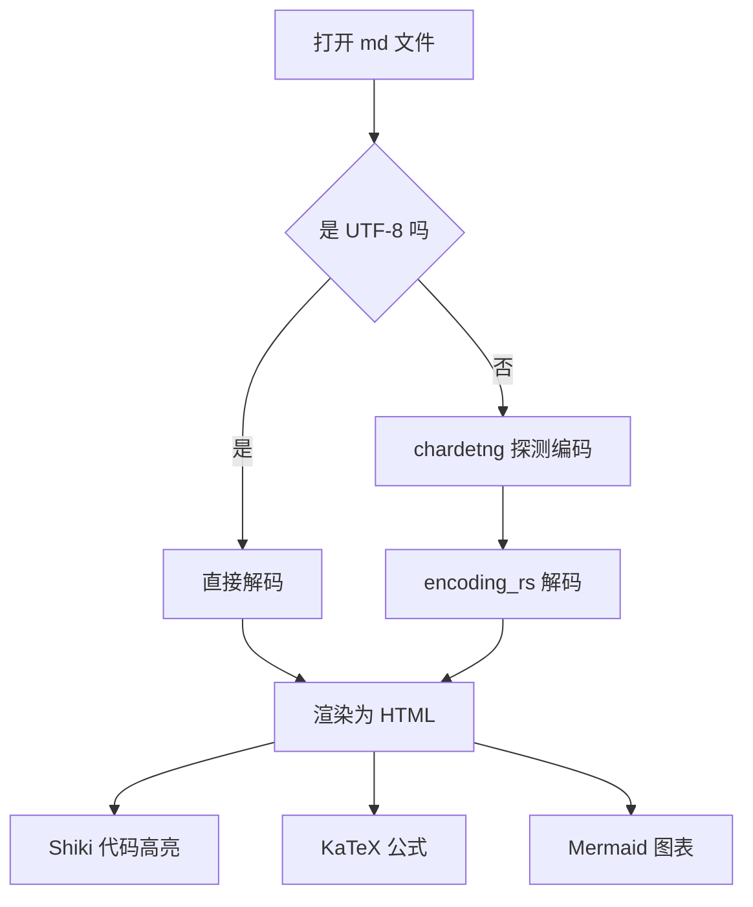
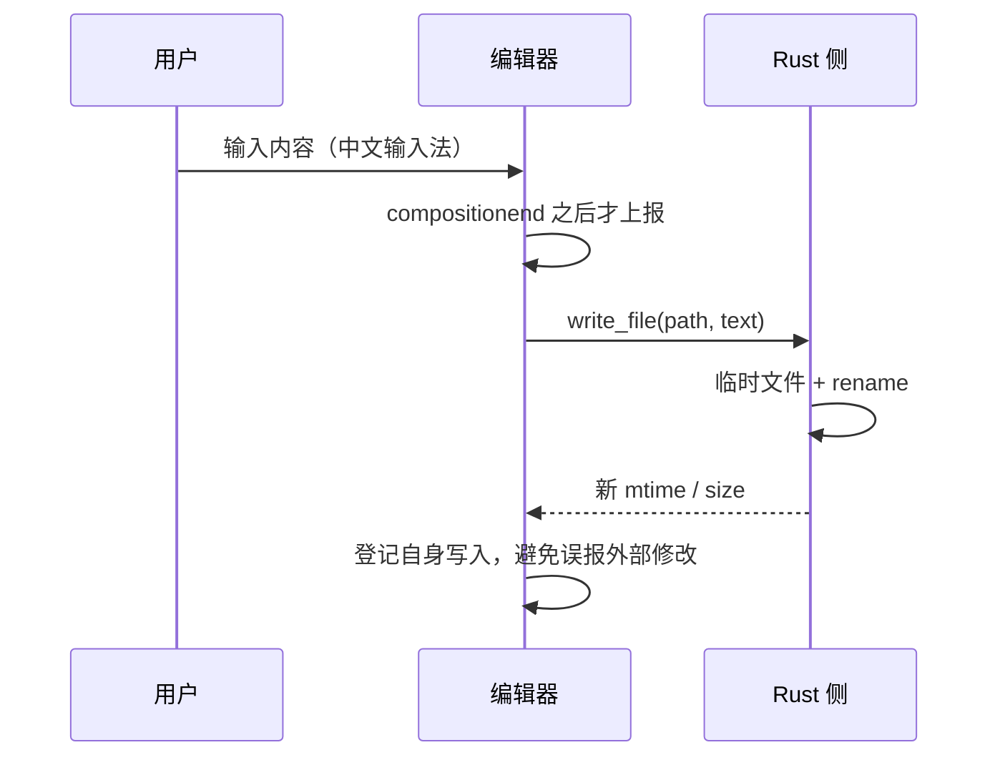

# Inkdown 功能自检

这份文档用来**逐项验证**渲染管线与编辑器行为。把它拖进窗口，或按 `Ctrl+O` 打开。

## 一、基础排版

普通段落。**加粗**、*斜体*、***粗斜体***、~~删除线~~、`行内代码`、[链接](https://tauri.app)。

中文与 English 混排 2024 年 12 月 31 日，标点符号「引号」、（括号）、—— 破折号。

> 引用块第一行
> 引用块第二行，应该和上一行在同一段引用里。
>
> 空行后的新段落，仍在同一个引用块中。

---

## 二、GFM 表格

| 项目 | 选型 | 备注 |
| --- | --- | --- |
| 外壳 | Tauri 2 | 体积小，走系统 WebView |
| 编辑器内核 | CodeMirror 6 | decoration 能力强 |
| 解析 | marked + DOMPurify | 快，且必须消毒 |
| 数学公式 | KaTeX | 同步渲染，比 MathJax 快 |

## 三、任务列表

- [x] 双栏编辑 + 实时预览
- [x] 中文字体与行高预设
- [x] 外部变更检测与冲突提示
- [ ] 全库搜索
- [ ] Git 集成

## 四、代码高亮（Shiki，双主题）

> 引用里放一个链接示例：[链接文字](https://codemirror.net)

```ts
// 切换主题时这里不需要重新高亮，颜色由 CSS 变量接管
export function createDoc(path: string, text: string): Doc {
  return {
    path,
    text,
    saved: "",
    encoding: "UTF-8",
    conflict: false,
  } as Doc;
}
```

```rust
// Rust 侧：原子写入，避免写一半崩溃损坏用户文件
fn write_atomic(path: &Path, bytes: &[u8]) -> std::io::Result<()> {
    let tmp = path.with_extension("tmp");
    std::fs::write(&tmp, bytes)?;
    std::fs::rename(&tmp, path)
}
```

```python
# 中文注释也应该正常显示
def word_count(text: str) -> int:
    cjk = sum(1 for ch in text if "\u4e00" <= ch <= "\u9fff")
          return cjk + len(text.split())
```

```bash
cargo check --manifest-path src-tauri/Cargo.toml
npm run app        # tauri dev
```

```sql
SELECT path, length(text) AS chars FROM documents WHERE chars > 10000;
```

## 五、数学公式（KaTeX）

行内公式：当 $a \ne 0$ 时，方程 $ax^2 + bx + c = 0$ 有两个解。

块级公式：

$$
x = \frac{-b \pm \sqrt{b^2 - 4ac}}{2a}
$$

矩阵与求和：

$$
\sum_{i=1}^{n} i = \frac{n(n+1)}{2}, \qquad
\begin{pmatrix} a & b \\ c & d \end{pmatrix}
$$

> 注意 "$100 和 $200" 这种写法不应该被误判成公式（价格过滤）。
[链接文字]([url](url))
## 六、Mermaid 图表





## 七、图片

本地图片按**文档所在目录**解析。若同目录下有 `assets/demo.svg`：


 图片加载失败时应显示断图占位，而不是让整个预览崩掉。

## 八、脚注与定义

带脚注的句子[^1]。

[^1]: 脚注内容在文末渲染。

## 九、中文排版检查清单

1. 中英混排时英文不应使用中文字体（否则字形会歪）。
2. 行高不低于 1.7，否则中文会挤成一团。
3. 一行 35–45 个汉字最舒服——对应约 42–50em 的字宽。
4. 单个换行是否断行，必须由用户决定（状态栏右下角可切）。
5. 表格里中英混排永远对不齐，**排版靠渲染层，不要靠空格**。

## 十、压力测试

打开一个 3–5 MB 的 markdown 文件，检查：

- 打开耗时（目标 < 300ms）
- 滚动是否掉帧
- 输入延迟（目标 P95 < 16ms）

## 十一、编码与换行

